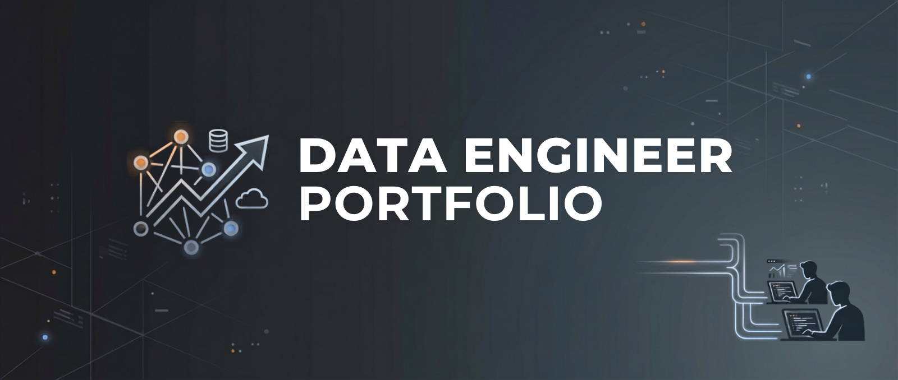

<h1 align="center">Emanuel Luis</h1>

  <strong>Data Engineer</strong> · ingestion · dbt modeling · orchestration · data platforms

  
  
  

---

### About

I'm a data engineer at PULSE, the IT department of Grupo Mateus in São Luís, Brazil, where I have
worked since August 2022. Most of my work is batch and CDC ingestion, dbt models on a Databricks
lakehouse, and the Airflow orchestration that runs them. I hold a B.S. in Software Engineering from
UNDB.

### Experience

**Data Engineer, PULSE** (IT department of Grupo Mateus) · Aug 2022 to present

- Design and maintain data pipelines that process millions of records a day from 20+ source
  systems: 700+ ingestion configs and about 90 dbt DAGs.
- Built a lakehouse on Azure and Databricks with a medallion layout (staging, bronze, gold) on
  Delta Lake and Unity Catalog.
- Cut one pipeline's runtime from about 60 minutes to 13 with a materialized change-tracking (CDC)
  system.
- Standardized batch, incremental and CDC ingestion from SQL Server and PostgreSQL with
  metadata-driven DAG generation: Jinja2 templates and JSON/YAML configs render the Airflow DAGs.
- Wrote a shared PySpark library for extraction and loading (full scan, incremental, CDC, Auto
  Loader), deployed to Databricks as wheels.
- Modeled dbt layers (bronze, staging, intermediate, marts) that run in Airflow through Astronomer
  Cosmos.
- Tuned Spark on Databricks (Liquid Clustering, broadcast joins), published Protobuf messages to
  Confluent Kafka, and ran reverse ETL with Apache NiFi.
- Ran containerized jobs on Azure Container Instances, with Docker images in Azure Container
  Registry.

### Tech

<table>
  <tr>
    <td><b>Languages &amp; processing</b></td>
    <td>
      
      
      
      
      
      
      
    </td>
  </tr>
  <tr>
    <td><b>Data engineering &amp; orchestration</b></td>
    <td>
      
      
      
      
      
      
      
      
      
      
      
      
    </td>
  </tr>
  <tr>
    <td><b>Platforms &amp; cloud</b></td>
    <td>
      
      
      
      
    </td>
  </tr>
  <tr>
    <td><b>Data stores &amp; query engines</b></td>
    <td>
      
      
      
      
      
    </td>
  </tr>
  <tr>
    <td><b>DevOps &amp; tooling</b></td>
    <td>
      
      
      
      
      
      
    </td>
  </tr>
  <tr>
    <td><b>Frameworks &amp; libraries</b></td>
    <td>
      
      
      
      
      
      
      
      
      
      
    </td>
  </tr>
</table>

### Projects

Personal projects, built on open or synthetic data.

#### Ingestion

| Project | What it does |
| --- | --- |
| [books-scraping](https://github.com/emanuel-luis/books-scraping) | Re-runnable crawl of the Books to Scrape sandbox (1,000 books) into a raw landing zone of HTML plus a manifest, then validated Parquet and a DuckDB serving layer. Loads upsert by UPC, so loading the same run twice changes nothing. |
| [ecommerce-scraping](https://github.com/emanuel-luis/ecommerce-scraping) | Scrapy crawler for three Brazilian fashion stores. It reads the schema.org Product JSON-LD in server-rendered pages, so it needs no browser, and writes redacted raw pages, Parquet partitioned by store and run date, and DuckDB views. |
| [ingestion-toolkit](https://github.com/emanuel-luis/ingestion-toolkit) | CLI that writes validated ingestion configs (full scan, incremental watermark, CDC) and renders each one into an Airflow 3 DAG with landing, bronze, rejects and run metadata. The watermark advances in the load transaction, so a retried run is idempotent. |
| [mssql-cdc-pyspark](https://github.com/emanuel-luis/mssql-cdc-pyspark) | PySpark streaming source for SQL Server CDC on Spark's Python DataSource V2 API. Offsets are commit LSNs, and a `finalized_until` signal tells downstream jobs when a period of data is safe to read. On [PyPI](https://pypi.org/project/mssql-cdc-pyspark/), with a [docs site](https://emanuel-luis.github.io/mssql-cdc-pyspark/). |

#### Streaming and CDC

| Project | What it does |
| --- | --- |
| [cdc-streaming-demo](https://github.com/emanuel-luis/cdc-streaming-demo) | Postgres changes go through Debezium and Kafka (Protobuf, Schema Registry) into an append-only Delta log written by Spark Structured Streaming, then into dbt-duckdb marts and a Streamlit dashboard. `make demo` checks 200 seeded mutations end to end, and one laptop run measured a p50 commit-to-lake lag of 41.7 s. A second path reads SQL Server CDC through mssql-cdc-pyspark. |
| [kafka-streaming-lakehouse](https://github.com/emanuel-luis/kafka-streaming-lakehouse) | Avro events flow through Kafka and Schema Registry into Apache Iceberg. A two-replica consumer group appends bronze idempotently and sends undecodable records to a DLQ; Spark Structured Streaming builds silver, Spark batch jobs build gold, and Trino queries every layer. `lakestream check` reconciles each layer with the run manifest. |

#### Lakehouse and modeling

| Project | What it does |
| --- | --- |
| [de-lakehouse-pipeline](https://github.com/emanuel-luis/de-lakehouse-pipeline) | ELT on Olist-shaped e-commerce data (seeded synthetic by default, or the open Olist dataset from Kaggle): Polars ingestion with typed data contracts, then dbt staging, bronze, intermediate and marts on DuckDB. An hourly Airflow 3 DAG runs each dbt model and test as its own task through Astronomer Cosmos, and Elementary reports on data quality. The dbt docs and the Elementary report are [on GitHub Pages](https://emanuel-luis.github.io/de-lakehouse-pipeline/). |
| [vaccine-warehouse](https://github.com/emanuel-luis/vaccine-warehouse) | Kimball-style warehouse for Brazilian childhood vaccination on Postgres, with Python ELT and dbt marts as the batch layer. A Spring Boot API adds a live speed layer with idempotent ingest and a watermark that keeps a dose from being counted twice, and a React dashboard behind Keycloak reads from it. Reference data is public; doses are synthetic. |

#### ML pipelines

| Project | What it does |
| --- | --- |
| [covid19-xray-pipeline](https://github.com/emanuel-luis/covid19-xray-pipeline) | DVC pipeline over three public chest X-ray datasets: 41,077 images after deduplication, group-aware splits with no leakage between them, 119 handcrafted features and a ResNet-18. On the same test split, the MLP baseline scores F1 0.9446 and the ResNet-18 0.9830. |
| [necrohub](https://github.com/emanuel-luis/necrohub) | Pipeline over synthetic pt-BR necropsy reports: generate, de-identify, fine-tune encoders and retrieve through pgvector. CI fails unless a clean run reproduces the committed `dvc.lock` and metrics. On held-out templates, a fine-tuned BioBERTpt encoder reaches strict PII F1 0.9444, against 0.6667 for regex. Synthetic data only. |

#### Applications

| Project | What it does |
| --- | --- |
| [bank-credit](https://github.com/emanuel-luis/bank-credit) | Credit-request workflow (FastAPI, Postgres, React). One service writes every state change to an append-only event log, enforced by a Postgres trigger and an ORM guard. SLA analytics are versioned SQL views, and exports are published with a manifest and sha256 only when their contract checks pass. |

### Open-source contributions

Two merged pull requests to [Astronomer Cosmos](https://github.com/astronomer/astronomer-cosmos), the
library that integrates dbt with Airflow:

- [#2201](https://github.com/astronomer/astronomer-cosmos/pull/2201) (December 2025):
  `DbtConsumerWatcherSensor` now carries the `template_fields` of `DbtRunLocalOperator`, so
  Watcher-mode sensors render Airflow templates when they fall back to local execution
  ([#2193](https://github.com/astronomer/astronomer-cosmos/issues/2193)). Includes tests.
- [#2241](https://github.com/astronomer/astronomer-cosmos/pull/2241) (January 2026): restores
  plain-text dbt logs, with CLI colors, in `ExecutionMode.WATCHER`. `FullOutputSubprocessHook` now
  logs through a `process_log_line` callable, and JSON output applies only to the `SUBPROCESS`
  invocation mode.

### Publications

Two 2022 publications from the COVID-19 research behind
[covid19-xray-pipeline](https://github.com/emanuel-luis/covid19-xray-pipeline), whose MLP baseline
re-implements the method of the first paper:

- Sousa Filho, E. L. C. de; Magno, P. G. S.; Santos, C. J. P.; Silva, G. L. F. da; Diniz, J. O. B.;
  Quintanilha, D. B. P. "Um Método Baseado em Radiomics e MLP para Diagnóstico Automático de
  COVID-19 a partir de Raio-X de Tórax" (a radiomics and MLP method for automatic COVID-19 diagnosis
  from chest X-rays). Anais da X ERCEMAPI, SBC, 2022, pp. 188-197.
  [doi:10.5753/ercemapi.2022.226508](https://doi.org/10.5753/ercemapi.2022.226508)
- Silva, G.; S. Filho, E.; Magno, P.; Santos, C.; Diniz, J.; Ferreira, J.; Matos, C.; Silva, A.
  "Desenvolvimento de uma aplicação web para o diagnóstico da COVID-19 usando conceitos, técnicas e
  ferramentas de Inteligência Artificial" (book chapter on building a web application for COVID-19
  diagnosis with AI). Minicursos da ERCEMAPI 2022, SBC, 2022, pp. 122-139.
  [doi:10.5753/sbc.11014.1.6](https://doi.org/10.5753/sbc.11014.1.6)

### Certifications

- Databricks Academy Accreditation: Databricks Fundamentals · Databricks · May 2026
- Computer Vision Training · Data Inception · May 2022
- Machine Learning Training · Data Inception · Mar 2022

### GitHub analytics

  
  

  

Education &amp; training

- B.S. Software Engineering, UNDB (Unidade de Ensino Superior Dom Bosco), São Luís, Brazil · 2021 to 2025
- Python and C# coursework on Udemy

